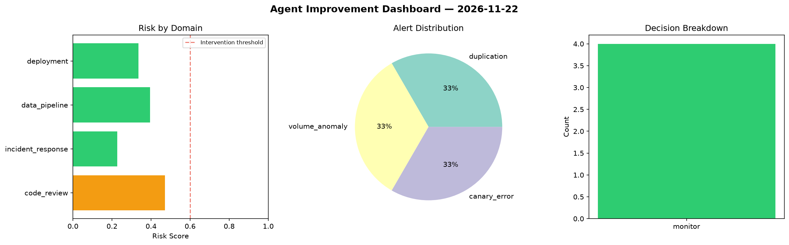

# Agent Improvement Report — 2026-11-22

**Cycle ID:** `bd955db1` | **Avg Risk:** 0.3571 | **Interventions:** 0/4

## Risk Matrix

| Domain | Risk Score | Decision | Alerts |
|--------|-----------|----------|--------|
| code_review | 0.471 | monitor | duplication |
| incident_response | 0.2265 | monitor | none |
| data_pipeline | 0.395 | monitor | volume_anomaly |
| deployment | 0.3358 | monitor | canary_error |

## Delta vs Yesterday

| Domain | Today | Yesterday | Change |
|--------|-------|-----------|--------|
| code_review | 0.471 | 0.6677 | 📉 -29.5% |
| incident_response | 0.2265 | 0.6365 | 📉 -64.4% |
| data_pipeline | 0.395 | 0.3733 | 📈 5.8% |
| deployment | 0.3358 | 0.3096 | 📈 8.5% |

**Refinement:** `{'adjustment': 'maintain', 'trend': 'improving', 'window': 4}`