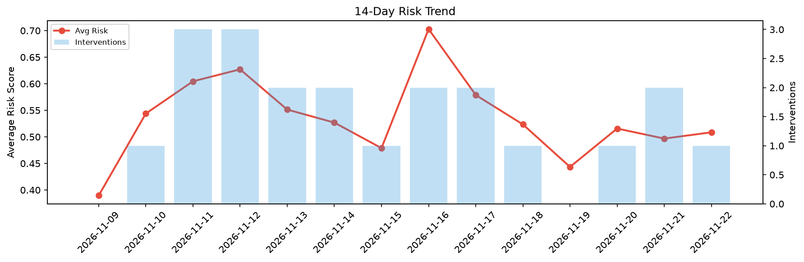

# Agent Improvement Report — 2026-11-22

**Cycle ID:** `8a33a0c8` | **Avg Risk:** 0.5086 | **Interventions:** 1/4

## Risk Matrix

| Domain | Risk Score | Decision | Alerts |
|--------|-----------|----------|--------|
| code_review | 0.7308 | intervene | coverage |
| incident_response | 0.5917 | monitor | severity, blast_radius |
| data_pipeline | 0.3594 | monitor | none |
| deployment | 0.3526 | monitor | none |

## Delta vs Yesterday

| Domain | Today | Yesterday | Change |
|--------|-------|-----------|--------|
| code_review | 0.7308 | 0.6677 | 📈 9.5% |
| incident_response | 0.5917 | 0.6365 | 📉 -7.0% |
| data_pipeline | 0.3594 | 0.3733 | 📉 -3.7% |
| deployment | 0.3526 | 0.3096 | 📈 13.9% |

**Refinement:** `{'adjustment': 'maintain', 'trend': 'improving', 'window': 4}`