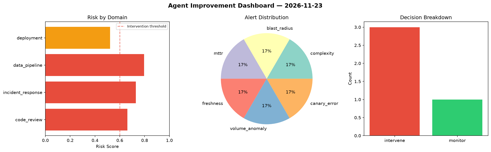
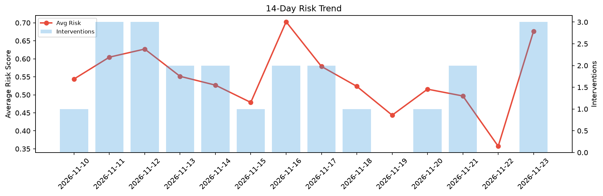

# Agent Improvement Report — 2026-11-23

**Cycle ID:** `92125627` | **Avg Risk:** 0.6767 | **Interventions:** 3/4

## Risk Matrix

| Domain | Risk Score | Decision | Alerts |
|--------|-----------|----------|--------|
| code_review | 0.6608 | intervene | complexity |
| incident_response | 0.729 | intervene | blast_radius, mttr |
| data_pipeline | 0.7955 | intervene | freshness, volume_anomaly |
| deployment | 0.5215 | monitor | canary_error |

## Delta vs Yesterday

| Domain | Today | Yesterday | Change |
|--------|-------|-----------|--------|
| code_review | 0.6608 | 0.471 | 📈 40.3% |
| incident_response | 0.729 | 0.2265 | 📈 221.9% |
| data_pipeline | 0.7955 | 0.395 | 📈 101.4% |
| deployment | 0.5215 | 0.3358 | 📈 55.3% |

**Refinement:** `{'adjustment': 'maintain', 'trend': 'improving', 'window': 4}`