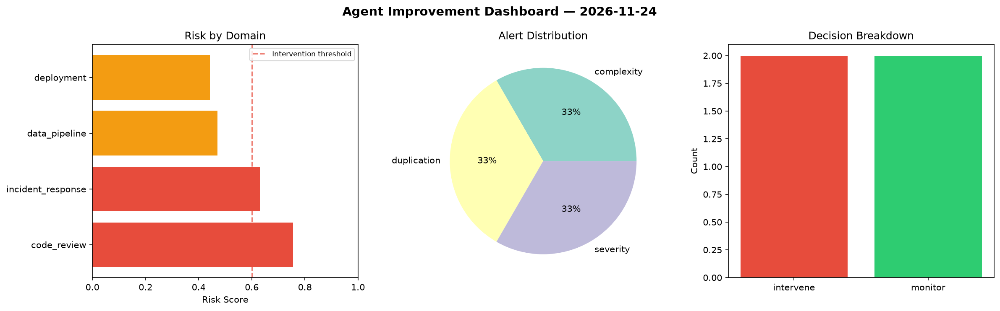

# Agent Improvement Report — 2026-11-24

**Cycle ID:** `8aece17f` | **Avg Risk:** 0.5749 | **Interventions:** 2/4

## Risk Matrix

| Domain | Risk Score | Decision | Alerts |
|--------|-----------|----------|--------|
| code_review | 0.7546 | intervene | complexity, duplication |
| incident_response | 0.6318 | intervene | severity |
| data_pipeline | 0.4703 | monitor | none |
| deployment | 0.4431 | monitor | none |

## Delta vs Yesterday

| Domain | Today | Yesterday | Change |
|--------|-------|-----------|--------|
| code_review | 0.7546 | 0.7152 | 📈 5.5% |
| incident_response | 0.6318 | 0.6008 | 📈 5.2% |
| data_pipeline | 0.4703 | 0.5259 | 📉 -10.6% |
| deployment | 0.4431 | 0.5757 | 📉 -23.0% |

**Refinement:** `{'adjustment': 'maintain', 'trend': 'improving', 'window': 4}`