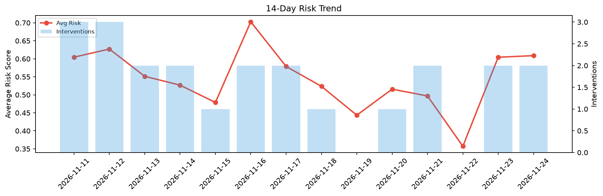

# Agent Improvement Report — 2026-11-24

**Cycle ID:** `05e0705b` | **Avg Risk:** 0.6088 | **Interventions:** 2/4

## Risk Matrix

| Domain | Risk Score | Decision | Alerts |
|--------|-----------|----------|--------|
| code_review | 0.5556 | monitor | coverage |
| incident_response | 0.6539 | intervene | mttr |
| data_pipeline | 0.5164 | monitor | volume_anomaly |
| deployment | 0.7092 | intervene | latency_p99 |

## Delta vs Yesterday

| Domain | Today | Yesterday | Change |
|--------|-------|-----------|--------|
| code_review | 0.5556 | 0.7152 | 📉 -22.3% |
| incident_response | 0.6539 | 0.6008 | 📈 8.8% |
| data_pipeline | 0.5164 | 0.5259 | 📉 -1.8% |
| deployment | 0.7092 | 0.5757 | 📈 23.2% |

**Refinement:** `{'adjustment': 'tighten_thresholds', 'trend': 'degrading', 'window': 4}`