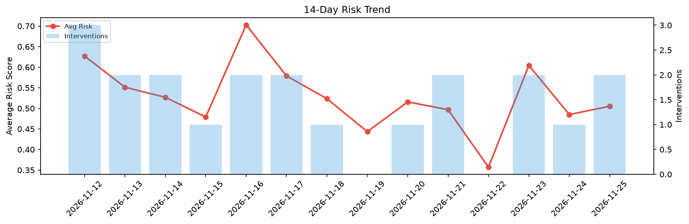

# Agent Improvement Report — 2026-11-25

**Cycle ID:** `6bb0b64f` | **Avg Risk:** 0.505 | **Interventions:** 2/4

## Risk Matrix

| Domain | Risk Score | Decision | Alerts |
|--------|-----------|----------|--------|
| code_review | 0.3497 | monitor | coverage |
| incident_response | 0.7684 | intervene | severity |
| data_pipeline | 0.665 | intervene | freshness, volume_anomaly |
| deployment | 0.237 | monitor | none |

## Delta vs Yesterday

| Domain | Today | Yesterday | Change |
|--------|-------|-----------|--------|
| code_review | 0.3497 | 0.359 | 📉 -2.6% |
| incident_response | 0.7684 | 0.5759 | 📈 33.4% |
| data_pipeline | 0.665 | 0.612 | 📈 8.7% |
| deployment | 0.237 | 0.3931 | 📉 -39.7% |

**Refinement:** `{'adjustment': 'maintain', 'trend': 'improving', 'window': 4}`