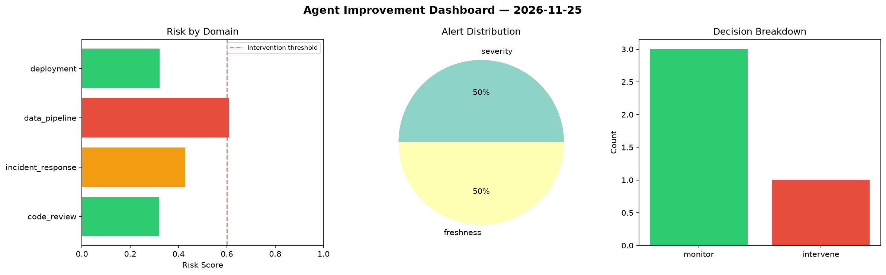

# Agent Improvement Report — 2026-11-25

**Cycle ID:** `c4973040` | **Avg Risk:** 0.4183 | **Interventions:** 1/4

## Risk Matrix

| Domain | Risk Score | Decision | Alerts |
|--------|-----------|----------|--------|
| code_review | 0.3188 | monitor | none |
| incident_response | 0.4264 | monitor | severity |
| data_pipeline | 0.6072 | intervene | freshness |
| deployment | 0.321 | monitor | none |

## Delta vs Yesterday

| Domain | Today | Yesterday | Change |
|--------|-------|-----------|--------|
| code_review | 0.3188 | 0.359 | 📉 -11.2% |
| incident_response | 0.4264 | 0.5759 | 📉 -26.0% |
| data_pipeline | 0.6072 | 0.612 | 📉 -0.8% |
| deployment | 0.321 | 0.3931 | 📉 -18.3% |

**Refinement:** `{'adjustment': 'tighten_thresholds', 'trend': 'degrading', 'window': 4}`