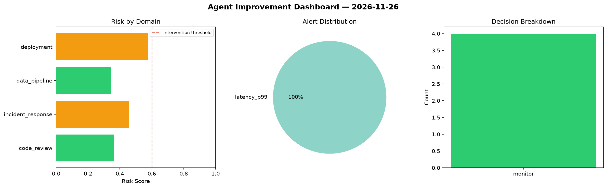
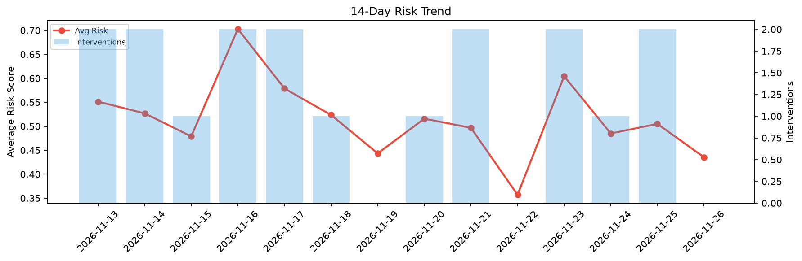

# Agent Improvement Report — 2026-11-26

**Cycle ID:** `71485c3c` | **Avg Risk:** 0.4355 | **Interventions:** 0/4

## Risk Matrix

| Domain | Risk Score | Decision | Alerts |
|--------|-----------|----------|--------|
| code_review | 0.3608 | monitor | none |
| incident_response | 0.4575 | monitor | none |
| data_pipeline | 0.3472 | monitor | none |
| deployment | 0.5766 | monitor | latency_p99 |

## Delta vs Yesterday

| Domain | Today | Yesterday | Change |
|--------|-------|-----------|--------|
| code_review | 0.3608 | 0.3497 | 📈 3.2% |
| incident_response | 0.4575 | 0.7684 | 📉 -40.5% |
| data_pipeline | 0.3472 | 0.665 | 📉 -47.8% |
| deployment | 0.5766 | 0.237 | 📈 143.3% |

**Refinement:** `{'adjustment': 'tighten_thresholds', 'trend': 'degrading', 'window': 4}`