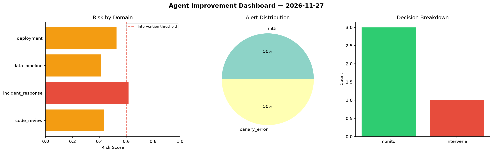
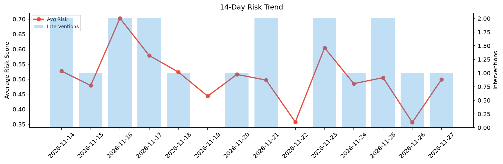

# Agent Improvement Report — 2026-11-27

**Cycle ID:** `9709d2a4` | **Avg Risk:** 0.4991 | **Interventions:** 1/4

## Risk Matrix

| Domain | Risk Score | Decision | Alerts |
|--------|-----------|----------|--------|
| code_review | 0.4377 | monitor | none |
| incident_response | 0.6176 | intervene | mttr |
| data_pipeline | 0.4126 | monitor | none |
| deployment | 0.5285 | monitor | canary_error |

## Delta vs Yesterday

| Domain | Today | Yesterday | Change |
|--------|-------|-----------|--------|
| code_review | 0.4377 | 0.2913 | 📈 50.3% |
| incident_response | 0.6176 | 0.6158 | 📈 0.3% |
| data_pipeline | 0.4126 | 0.0614 | 📈 572.0% |
| deployment | 0.5285 | 0.4554 | 📈 16.1% |

**Refinement:** `{'adjustment': 'tighten_thresholds', 'trend': 'degrading', 'window': 4}`