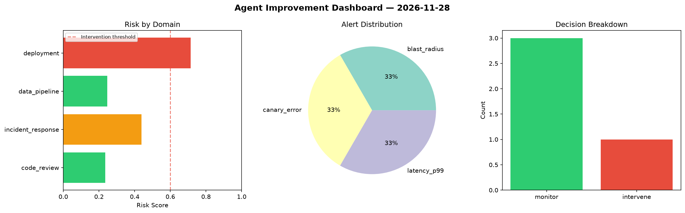

# Agent Improvement Report — 2026-11-28

**Cycle ID:** `4063bd6f` | **Avg Risk:** 0.4085 | **Interventions:** 1/4

## Risk Matrix

| Domain | Risk Score | Decision | Alerts |
|--------|-----------|----------|--------|
| code_review | 0.2346 | monitor | none |
| incident_response | 0.4388 | monitor | blast_radius |
| data_pipeline | 0.2462 | monitor | none |
| deployment | 0.7144 | intervene | canary_error, latency_p99 |

## Delta vs Yesterday

| Domain | Today | Yesterday | Change |
|--------|-------|-----------|--------|
| code_review | 0.2346 | 0.4377 | 📉 -46.4% |
| incident_response | 0.4388 | 0.6176 | 📉 -29.0% |
| data_pipeline | 0.2462 | 0.4126 | 📉 -40.3% |
| deployment | 0.7144 | 0.5285 | 📈 35.2% |

**Refinement:** `{'adjustment': 'tighten_thresholds', 'trend': 'degrading', 'window': 4}`