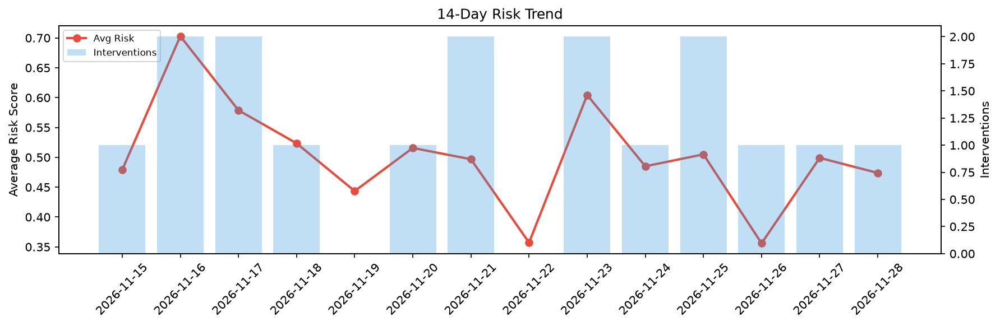

# Agent Improvement Report — 2026-11-28

**Cycle ID:** `de566227` | **Avg Risk:** 0.4738 | **Interventions:** 1/4

## Risk Matrix

| Domain | Risk Score | Decision | Alerts |
|--------|-----------|----------|--------|
| code_review | 0.395 | monitor | none |
| incident_response | 0.6017 | intervene | severity |
| data_pipeline | 0.5086 | monitor | freshness |
| deployment | 0.3901 | monitor | latency_p99 |

## Delta vs Yesterday

| Domain | Today | Yesterday | Change |
|--------|-------|-----------|--------|
| code_review | 0.395 | 0.4377 | 📉 -9.8% |
| incident_response | 0.6017 | 0.6176 | 📉 -2.6% |
| data_pipeline | 0.5086 | 0.4126 | 📈 23.3% |
| deployment | 0.3901 | 0.5285 | 📉 -26.2% |

**Refinement:** `{'adjustment': 'maintain', 'trend': 'improving', 'window': 4}`